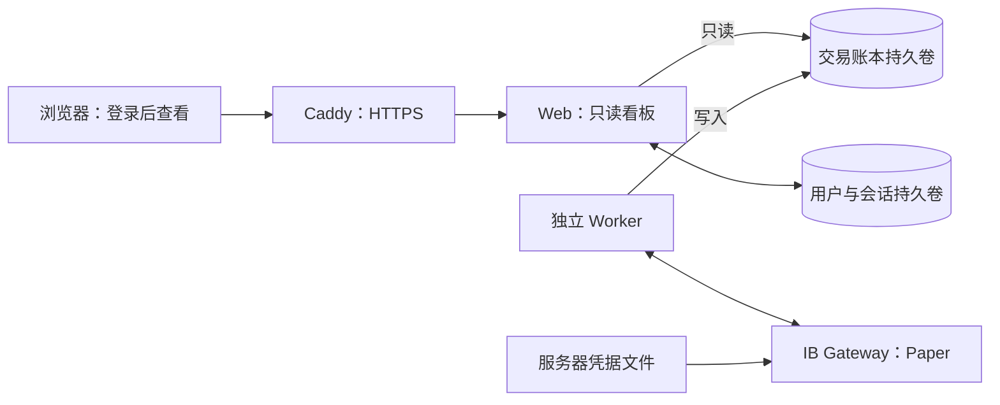

# 在云端部署并查看 IBKR 模拟交易看板

整套服务运行在云服务器；你只需浏览器使用服务器控制台和看板。无需电脑安装 Python、Docker、TWS 或 IB Gateway。IBKR 登录仍可能需要你在手机上批准 IB Key/双重认证，不能绕过券商认证。

当前交付的是经过测试的代码和部署配置。**尚未购买或配置公网服务器/域名，也没有登录你的 IBKR 账户，所以目前没有真实公网看板地址或模拟成交结果。** 当前开发云机器中的 Web/worker 只供内部验证，不能作为全天候公网托管承诺。

## 服务组成



网页没有通向下单函数的调用。Gateway API、8090 Web 内部端口及远程桌面端口都不暴露公网。Web 容器拿不到 Gateway 密码文件；凭据不打包进镜像或发送给浏览器。

## 1. 准备云服务器与域名

在任选云服务商购买 **x86-64/AMD64 Ubuntu 24.04** 服务器，至少2核4GB内存，建议8GB内存和20GB以上磁盘。已固定的 Gateway 镜像是 AMD64，勿直接选 ARM 机器。

通过服务商的浏览器终端操作。域名或子域名的 DNS A 记录指向服务器公网 IPv4；开放公网80和443端口。浏览器终端或SSH管理入口按云服务商说明保留。不要开放4002/4004/5900/8090给公网。

在服务器终端安装运行环境：

```bash
sudo apt-get update
sudo apt-get install -y docker.io docker-compose-v2 unzip git
sudo systemctl enable --now docker
```

可直接在服务器浏览器终端从本仓库获取首版源码，不需要上传账户文件：

```bash
git clone https://github.com/ShirakawaRyou/MyQuant.git
cd MyQuant/deploy
```

也可上传并解压 GitHub 的 Code → Download ZIP 文件，进入其中的 `deploy` 目录。源码不含账户凭据、运行数据库或私有日志。

## 2. 仅在服务器输入 IBKR 凭据

```bash
sudo python3 configure.py
```

程序询问域名、**用于 Paper Trading 的登录用户名/密码**以及可选 DU 账户号。密码不回显、不放进命令参数或Shell历史，只写入 `deploy/secrets/ibkr_password`（0600、Gateway所需UID1000）；用户名在服务器 `.env`（0600）。这两个路径都被 Git 与镜像构建排除。已有文件不会被盲目覆盖。

不要把 IBKR 密码发到聊天、写入前端、放入 Git，或把平台 HTTPS 代理占位凭据当作 Gateway 本地密码。网关需要可供官方客户端直接使用的服务器私有文件。

Gateway 使用第三方维护项目 [gnzsnz/ib-gateway-docker](https://github.com/gnzsnz/ib-gateway-docker/tree/11d3eeb945f3cdfc4859dbe5a2c75acd18f18d53) 打包官方客户端和 IBC；已固定版本与镜像摘要。它不是本项目编写的认证服务，也不是浏览器插件。容器内部纸面 API 入口为4004，对应网关内4002。

## 3. 构建、启动与设置看板登录

```bash
sudo docker compose config --quiet
sudo docker compose build web worker
sudo docker compose up -d gateway worker
sudo docker compose run --rm --no-deps web myquant-admin set-password --username owner
sudo docker compose up -d web caddy
sudo docker compose ps
```

看板密码是独立密码，至少14个字符，在云终端隐藏输入两次，仅保存加盐 PBKDF2 哈希。没有出厂默认密码。完成 IB Key 认证后，在服务器查看 Gateway 与 Worker 的私有日志确认登录状态：

```bash
sudo docker compose logs --tail 50 gateway worker
```

不要把可能含账户标识的日志发布到公共网站。若券商登录或2FA未完成，先停止网关并核对，避免无意义地反复重启猜密码。Gateway可能需要重新认证，不能保证永远无人干预。

服务器需能访问 IBKR 官方登录与行情服务。行情与历史数据权限和拥有模拟账户是两回事；缺权限时看板显示缺失/等待信息，后台不使用虚构或过期行情下单。

## 4. 从浏览器查看

DNS和证书签发成功后，打开 **`https://你的域名`**，用刚设置的看板用户名 `owner` 和看板密码登录。Caddy自动提供HTTPS。若DNS尚未生效或80/443不可达，先修正入口；不能用伪造的“已部署链接”代替。

先检查：

- 顶部始终显示“模拟交易 · IBKR PAPER”，账户号为预期的 DU 模拟账户。
- 账户同步时间、后台心跳和最近已收盘日线符合预期。断线后保留旧数据并提示延迟，不会以0冒充最新资产。
- “信号”“订单”“成交”是三个独立页签；只有执行回报才生成成交记录。
- 净资产变化包含出入金；“券商当日盈亏”是每日重置的IBKR读数，两者没有混称累计策略收益。

页面自动每10秒读状态，刷新按钮、页面刷新、关闭页面、退出看板登录均不提交或撤销订单。

## 5. 从监控切换到模拟执行

默认 **仅监控**。确认DU账户、行情权限和预算正确后，在服务器安全编辑 `.env`：

```text
IBKR_READ_ONLY_API=no
PAPER_ORDERS_ENABLED=true
```

然后重建对应进程：

```bash
sudo docker compose up -d --force-recreate gateway worker
```

后台只支持DU模拟账户，拒绝实盘账户。策略读取 `research/protocol.json` 的20/60均线与10万美元预算；需要新鲜实时买卖报价、充足美元现金和已核对的本策略持仓。存在手工仓位、缺行情、缺日线、挂单或不确定提交状态时会等待，不强制处置。

先观察少量模拟订单的状态和执行回报。当前尚未用你的账户实际验证登录、订单接受或成交；测试中的假券商对象不等于IBKR联调成功。限价DAY订单不保证成交，也不保证复刻历史回测的开盘成交价。

## 6. 后台独立运行、重启与记录保存

生产服务使用 Docker `restart: unless-stopped`。关浏览器不影响后台；只停止 Web 也不停止 Worker：

```bash
sudo docker compose stop web
sudo docker compose up -d web
```

如要暂停新的策略操作，在服务器停止 Worker：

```bash
sudo docker compose stop worker
```

**停止 Worker 不自动撤销已经进入 IBKR 的订单。** 仍需在官方纸面账户界面核对挂单。再次启动时先核对状态，无法确定的提交保留“待核对”，不盲目重发。

`trading` 保存信号、订单、成交、手续费、资产与PnL时间序列；`auth` 保存密码哈希和会话；Gateway配置与HTTPS证书也有独立持久卷。容器重建或普通 `docker compose down` 不删除这些卷。**不要在保留记录时运行 `docker compose down -v`。** 云服务器关机、销毁或开发云环境暂停会停止进程；仅关闭看板不会。

在线一致性备份交易账本：

```bash
sudo docker compose exec web myquant-admin backup --out /tmp/paper-backup.sqlite3
sudo docker compose cp web:/tmp/paper-backup.sqlite3 ./paper-backup.sqlite3
sudo chmod 600 paper-backup.sqlite3
```

每次备份选择新的输出路径。备份应保存在服务器受限目录或加密备份服务中，不提交Git。登录后也可从各页签导出完整CSV；页面只显示最近300条，数据库持续保留全部已获取记录。

修改看板密码：重新运行 `myquant-admin set-password`，旧会话会失效。IBKR密码只在服务器凭据文件中更新，并重启Gateway；不从看板提供凭据编辑功能。

## 验证与当前限制

实际已执行的检查见 [VERIFICATION.md](VERIFICATION.md)。公网HTTPS签发、你的IBKR登录、行情权限与真实模拟成交属于部署后的验收，当前尚未验证。

IBKR能回取的历史订单/成交有时间范围限制；从部署开始持续保存，不承诺自动恢复停机间隔及部署前全部历史。未知订单需要人工核对；当前不提供网页下单、改撤单或人工覆盖状态。后台不自动接管手工持仓，拆股造成股数与策略账本不一致时暂停并提示核对。
