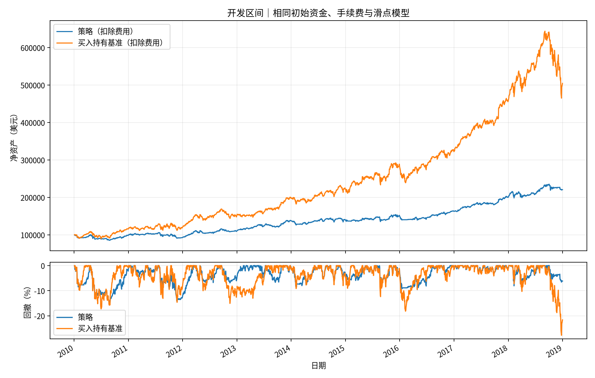

# 开发区间回测报告

回测日期：2010-01-04 至 2018-12-31。共 2264 个交易日；金额单位为美元。

| 指标 | 策略（扣除费用） | 买入持有基准（扣除费用） |
|---|---:|---:|
| 累计收益 | 120.67% | 404.59% |
| 年化收益 | 9.21% | 19.74% |
| 最大回撤 | 14.89% | 27.79% |
| 平均仓位 | 63.02% | 95.89% |
| 年化波动率 | 11.47% | 18.33% |
| 期初净资产 | 100,000.00 | 100,000.00 |
| 期末净资产 | 220,671.38 | 504,588.39 |
| 手续费合计 | 5,702.69 | 9.19 |
| 滑点成本合计 | 3,529.06 | 49.81 |
| 隔离分红余额 | 15,137.81 | 29,649.65 |
| 夏普比率（无风险利率按零计） | 0.83 | 1.07 |
| 成交笔数 | 5525 | 5 |

## 查看每笔操作

[中文成交记录](成交记录.csv) · [基准成交记录](基准成交记录.csv) · [每日持仓](每日持仓.csv) · [资产曲线](资产曲线.csv) · [拆股及分红](公司行动.csv) · [未成交记录](未成交记录.csv)

成交记录中每行是一笔模拟成交，不是一轮完整买卖。成交价已包含滑点；滑点成本是其中不利价差的单独披露，不能再次扣除。手续费另计。成交后现金不包括隔离分红。仓位与回撤表中的比例使用小数表示，例如 0.2 为 20%。

## 策略与计算口径

股票池：AAPL、AMZN、JNJ、JPM、MSFT。快均线 20 日，慢均线 60 日；快线高于慢线时目标仓位 20%，否则目标为零。收盘判断，下一交易日开盘再平衡；先卖后买，共享现金，不融资、不做空。

已显式处理拆股与分红。分红在除息日计入隔离权益，期间不再投资；期末按市价估值，不强制卖出。基准使用同样的初始资金和费用模型。

历史结果不代表未来收益。固定存续股票池存在幸存者与选择偏差；当前数据快照可能含事后修订。日线模型不完整模拟税、利息、交收、市场冲击或成交量限制。

原始英文字段 CSV 与 summary.json 用于程序读取及溯源；中文表格采用带字节顺序标记的 UTF-8 编码。
